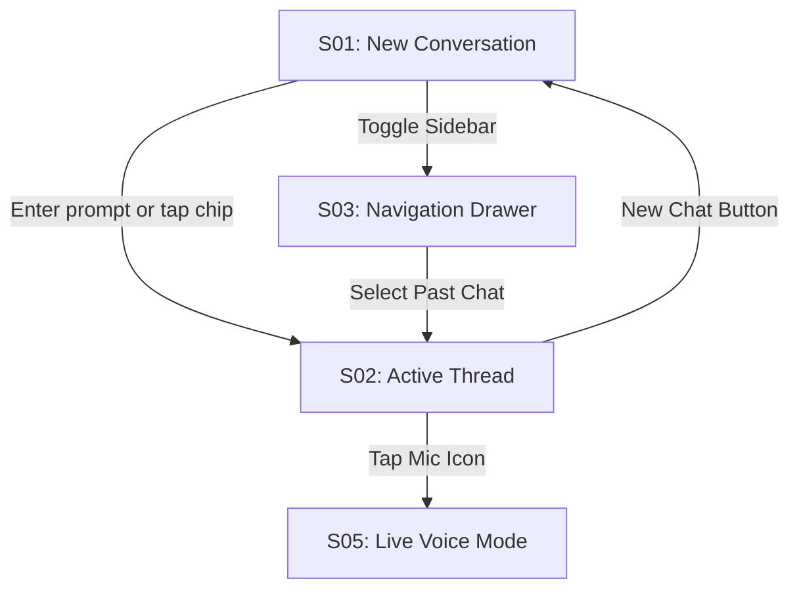
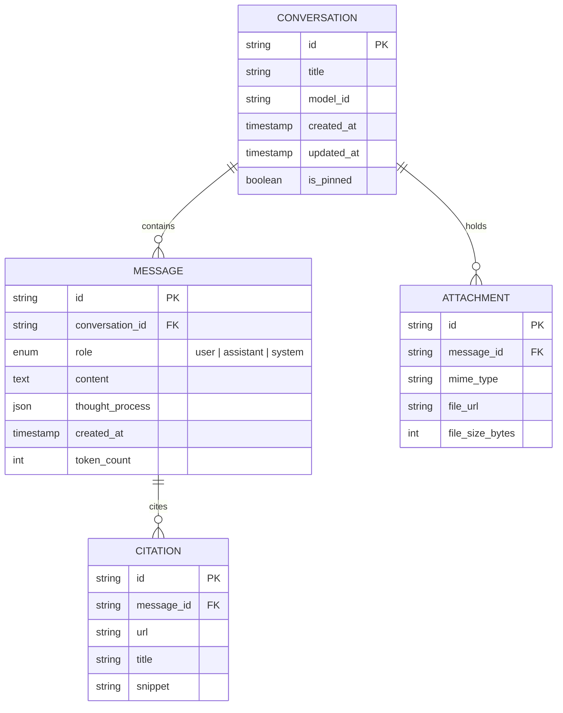

# Replica Reconnaissance Map: Google Gemini Web App (`gemini.google.com/app`)

Reverse-engineered architectural blueprint, screen inventory, component specifications, and data model for a clean-room, unbranded clone.

---

## 1. Screen Inventory

| Screen ID | Name                                   | Route / State            | Description                                                                                                                                                                                                                     |
| :-------- | :------------------------------------- | :----------------------- | :------------------------------------------------------------------------------------------------------------------------------------------------------------------------------------------------------------------------------ |
| **S01**   | **New Conversation (Zero State)**      | `/app`                   | Central personalized greeting (`"Bonjour, aphro"`), model switcher dropdown, dynamic prompt suggestion chips (4x grid), and floating bottom input capsule.                                                                      |
| **S02**   | **Active Conversation Thread**         | `/app/<conversation_id>` | Scrollable linear chat history, alternating user query bubble and AI markdown response block with live typing/streaming tokens.                                                                                                 |
| **S03**   | **Collapsible Sidebar (Navigation)**   | Global Overlay / Drawer  | Left-side navigation bar (collapsed: 68px icon rail; expanded: 280px drawer) containing "New chat" button, pinned conversations, chronologically grouped history (`Today`, `Yesterday`, `Previous 7 days`), Settings, and Help. |
| **S04**   | **Floating Input Dock (Omni Capsule)** | Global Footer Component  | Pill-shaped text area (`min-height: 56px`, `max-height: 200px`), file upload button (+ menu: files, photos, audio), microphone / voice button, and circular submit button.                                                      |
| **S05**   | **Live Voice & Multimodal Overlay**    | Modal / Fullscreen Dock  | Radial audio visualizer or dynamic glowing orb with 32-band FFT reactive animations, live transcript subtitle bar, and barge-in / mute controls.                                                                                |

---

## 2. Key User Flows

1. **Zero-State to Dialogue (Happy Path)**:
   - User lands on `/app`.
   - Sees greeting + model selector (`Gemini 3.8 Flash` / `Gemini 4 Argon`).
   - Clicks a prompt chip or types query in the floating pill dock.
   - Transitions smoothly to `/app/<conversation_id>` with streaming response.
2. **Context Switching via Sidebar**:
   - User hovers or taps hamburger menu to expand sidebar.
   - Selects a previous conversation; state updates dynamically with scroll-to-bottom.
3. **Voice Interaction (Speech-to-Speech)**:
   - User clicks the microphone icon in the omni capsule.
   - Activates full-duplex speech streaming mode (Voice Orb + audio loopback).

---

## 3. Inferred Data Model

---

## 4. Feature Matrix

- [x] **Must**: Multi-turn linear conversational stream (Server-Sent Events / WebSocket).
- [x] **Must**: Auto-resizing pill input dock with file attachment preview.
- [x] **Must**: Markdown rendering (code blocks with syntax highlighting, tables, math LaTeX).
- [x] **Must**: Responsive collapsible sidebar with grouped historical sessions.
- [x] **Should**: Real-time voice mode visualizer (SVG orb / FFT spectrum).
- [x] **Should**: Light and Dark mode with contrast-safe tokens.
- [x] **Could**: Extension tools integration (search grounding, media playback).
